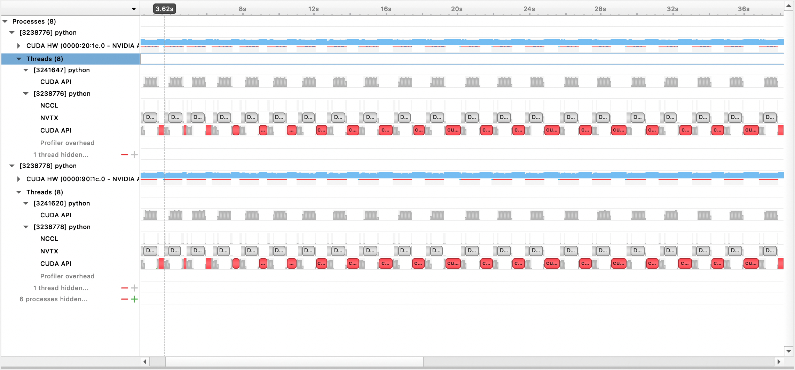
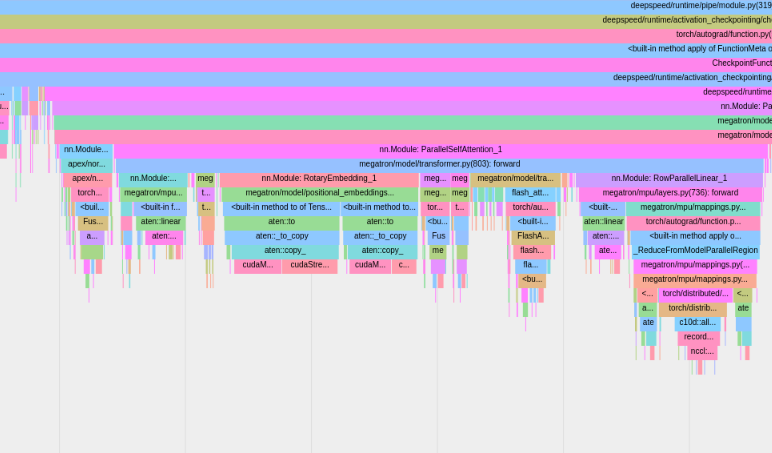
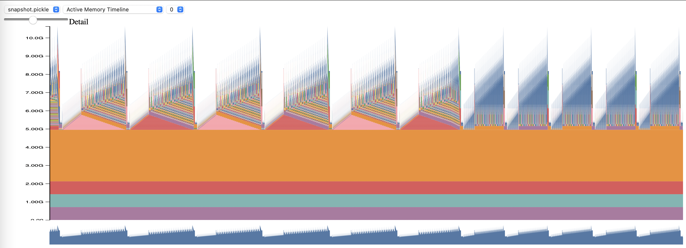

[](https://github.com/EleutherAI/gpt-neox/issues)
[](https://wandb.ai/eleutherai/neox)

# GPT-NeoX

<p align="center">
  <a href="README.md">English</a> · <b>简体中文</b>
</p>

本仓库收录了 [EleutherAI](https://www.eleuther.ai) 用于在 GPU 上训练大规模语言模型的官方代码库。我们当前的框架基于 NVIDIA 的 [Megatron Language Model](https://github.com/NVIDIA/Megatron-LM)，并结合了来自 [DeepSpeed](https://www.deepspeed.ai) 的核心技术以及一系列全新优化。我们的目标是将此代码库打造为一个集中且易于访问的平台，汇聚大规模自回归语言模型的训练技术，加速大规模训练领域的前沿研究。

GPT-NeoX 已被学术界、工业界和政府机构的 40 多个组织用于训练了 50 多个大语言模型。代表性案例包括 EleutherAI 的 Pythia、Stability AI 的 StableLM、Together.ai 的 RedPajama-INCITE、橡树岭国家实验室（ORNL）的 FORGE、SB Intuitions 的 Sarashina1 以及 Tilde 的 TildeOpen-30B。Arc Institute 的 Evo 2 则是使用源自 GPT-NeoX 的 Savanna 框架训练的。GPT-NeoX 支持通过 Slurm、MPI 和 IBM Job Step Manager 启动任务，已在 [AWS](https://aws.amazon.com/)、[CoreWeave](https://www.coreweave.com/)、[ORNL Summit](https://www.olcf.ornl.gov/summit/)、[ORNL Frontier](https://www.olcf.ornl.gov/frontier/)、[LUMI](https://www.lumi-supercomputer.eu/) 和 [CINECA Leonardo](https://leonardo-supercomputer.cineca.eu/) 等超级计算平台上大规模运行于 NVIDIA 和 AMD GPU。模型与研究成果的完整列表请参见 [USERS.md](USERS.md)。

**如果您不需要从零开始训练数十亿参数规模的模型，这可能不是适合您的库。对于常规的推理需求，我们建议使用 Hugging Face 的 `transformers` 库，该库原生支持 GPT-NeoX 模型。**

## 为什么选择 GPT-NeoX？

GPT-NeoX 借鉴了广受欢迎的 Megatron-DeepSpeed 库中的诸多相同特性和底层技术，但在易用性和前沿优化方面进行了大幅增强。主要特性包括：
* 基于 ZeRO 和 3D 并行（数据、张量、流水线并行）的分布式训练
* 广泛的系统与硬件支持：支持通过 Slurm、MPI 和 IBM Job Step Manager 进行任务启动，并已在 [AWS](https://aws.amazon.com/)、[CoreWeave](https://www.coreweave.com/)、橡树岭国家实验室的 [Summit](https://www.olcf.ornl.gov/summit/) 与 [Frontier](https://www.olcf.ornl.gov/frontier/)、[太平洋西北国家实验室 (PNNL)](https://hpc.pnl.gov/index.shtml)、阿贡国家实验室的 [Polaris](https://docs.alcf.anl.gov/polaris/data-science-workflows/applications/gpt-neox/)、[LUMI](https://www.lumi-supercomputer.eu/) 等超算上完成超大规模集群验证
* 尖端模型架构创新：包含 Rotary（RoPE）与 ALiBi 位置编码、并行前馈注意力层（Parallel Attention）以及 Flash Attention
* 主流经典架构的预置配置：涵盖 Pythia、PaLM、Falcon 以及 LLaMA 1 & 2
* 课程学习（Curriculum Learning）
* 与开源生态无缝打通：支持 Hugging Face 的 [tokenizers](https://github.com/huggingface/tokenizers) 和 [transformers](https://github.com/huggingface/transformers/) 库，通过 [WandB](https://wandb.ai/site)/[Comet](https://www.comet.com/site/)/TensorBoard 监控实验，并通过我们的 [Language Model Evaluation Harness](https://github.com/EleutherAI/lm-evaluation-harness) 进行标准化模型评测。

## 版本演进

在 2023 年 3 月 9 日之前，GPT-NeoX 依赖于 [DeeperSpeed](https://github.com/EleutherAI/DeeperSpeed)（基于旧版 DeepSpeed 0.3.15 分支）。为了迁移到最新的上游 DeepSpeed 版本，同时允许用户继续访问历史稳定版本，我们为这两个库引入了两个版本发布分支：

- [GPT-NeoX v2.0](https://github.com/EleutherAI/gpt-neox/releases/tag/v2.0) 与 [DeeperSpeed v2.0](https://github.com/EleutherAI/DeeperSpeed/releases/tag/v2.0)：构建于最新 DeepSpeed 之上的最新版本，也是后续持续维护的活跃版本。
- [GPT-NeoX v1.0](https://github.com/EleutherAI/gpt-neox/releases/tag/v1.0) 与 [DeeperSpeed v1.0](https://github.com/EleutherAI/DeeperSpeed/releases/tag/v1.0)：保留了用于训练 [GPT-NeoX-20B](https://arxiv.org/abs/2204.06745) 和 [Pythia Suite](https://github.com/EleutherAI/pythia) 的旧稳定版本快照。

# 目录

- [GPT-NeoX](#gpt-neox)
  * [为什么选择 GPT-NeoX？](#为什么选择-gpt-neox)
  * [版本演进](#版本演进)
- [目录](#目录)
- [快速上手](#快速上手)
  * [环境与依赖配置](#环境与依赖配置)
    + [主机环境配置](#主机环境配置)
    + [融合算子内核 (Fused Kernels)](#融合算子内核-fused-kernels)
    + [Flash Attention](#flash-attention)
    + [Transformer Engine](#transformer-engine)
    + [多节点任务启动](#多节点任务启动)
    + [容器化运行配置](#容器化运行配置)
  * [使用方法](#使用方法)
- [模型配置](#模型配置)
    * [混合专家模型 (Mixture of Experts)](#混合专家模型-mixture-of-experts)
- [数据集处理](#数据集处理)
  * [预置数据集](#预置数据集)
  * [使用自定义数据](#使用自定义数据)
- [训练与微调](#训练与微调)
  * [开源预训练模型](#开源预训练模型)
    + [GPT-NeoX-20B](#gpt-neox-20b)
    + [Pythia](#pythia)
    + [Polyglot](#polyglot)
- [模型推理](#模型推理)
- [模型评测](#模型评测)
- [导出至 Hugging Face](#导出至-hugging-face)
- [实验监控与可观测性](#实验监控与可观测性)
  * [Weights & Biases](#weights--biases)
  * [TensorBoard](#tensorboard)
  * [Comet](#comet)
- [多节点运行配置](#多节点运行配置)
- [性能分析 (Profiling)](#性能分析-profiling)
- [业界采用与学术论文](#业界采用与学术论文)
- [项目维护与引用](#项目维护与引用)
  * [引用 GPT-NeoX](#引用-gpt-neox)
  * [参与贡献](#参与贡献)
  * [开源许可证](#开源许可证)
  * [致谢](#致谢)

# 快速上手

## 环境与依赖配置

### 主机环境配置

本代码库主要针对 Python 3.8-3.10 以及 PyTorch 1.8-2.0 进行开发与测试。这并非绝对限制，其他版本与依赖组合亦可能正常运行。

在仓库根目录下运行以下命令以安装基础依赖：

```bash
pip install -r requirements/requirements.txt
pip install -r requirements/requirements-wandb.txt # 可选：若使用 WandB 记录日志
pip install -r requirements/requirements-tensorboard.txt # 可选：若使用 TensorBoard 记录日志
pip install -r requirements/requirements-comet.txt # 可选：若使用 Comet 记录日志
```

> [!WARNING]
> 本代码库依赖于 [DeeperSpeed](https://github.com/EleutherAI/DeeperSpeed)（我们基于 [DeepSpeed](https://github.com/microsoft/DeepSpeed) 添加了特定修改的分支）。强烈建议在继续之前使用 Conda 环境、虚拟环境或容器进行隔离，否则可能破坏其他依赖原生 DeepSpeed 的项目。

### 融合算子内核 (Fused Kernels)

我们现已通过 JIT 融合算子编译支持 AMD GPU（MI100、MI250X）。融合算子将根据需要在运行时按需编译加载。为避免在启动训练任务时产生编译等待，您也可以手动执行预编译：

```python
python
from megatron.fused_kernels import load
load()
```

该工具会自动适应不同 GPU 厂商（AMD、NVIDIA）的构建过程，无需修改平台专用代码。若要使用 `pytest` 测试融合算子，请运行：`pytest tests/model/test_fused_kernels.py`。

### Flash Attention

若要使用 [Flash-Attention](https://github.com/HazyResearch/flash-attention)，请安装 `./requirements/requirements-flashattention.txt` 中的额外依赖，或使用预装该库的 PyTorch NGC 容器（注意：使用与依赖文件不同的版本不保证完全兼容）。随后在配置文件中指定对应的 attention 类型（参见 [configs](./configs/)）。在 Ampere 架构（如 A100）等 GPU 上，这能带来相对于常规注意力算子的显著加速。

### Transformer Engine

若要使用 [Transformer Engine (TE)](https://github.com/NVIDIA/TransformerEngine)，请安装 `./requirements/requirements-transformer-engine.txt` 中的额外依赖，或使用预装它的 PyTorch NGC 容器。在 1.3B 模型上使用 TE 的示例配置可见 [此配置文件](https://github.com/EleutherAI/gpt-neox/blob/main/configs/1-3B-transformer-engine.yml)。在 Ampere 和 Hopper 架构 GPU 上，TE 能提供极其高效的计算内核与显著加速。

### 多节点任务启动

NeoX 与 Deep(er)Speed 支持跨多个不同节点进行分布式训练，并支持多种调度启动器来编排多节点作业。

通常需要在集群可访问的位置提供一份形如以下的 `hostfile` 配置文件：

```bash
node1_ip slots=8
node2_ip slots=8
```

其中第一列为集群中各节点的 IP 地址，`slots` 为该节点可用的 GPU 数量。在训练配置中必须通过 `"hostfile": "/path/to/hostfile"` 传入该文件路径，或者设置环境变量 `DLTS_HOSTFILE` 指向该文件。

#### pdsh

`pdsh` 是默认的启动器。如果使用 `pdsh`，除了确保环境中已安装 pdsh 之外，只需在配置文件中设置 `{"launcher": "pdsh"}` 即可。

#### MPI

若使用 MPI，必须指定 MPI 库实现（DeepSpeed/GPT-NeoX 当前支持 `mvapich`、`openmpi`、`mpich` 和 `impi`，其中 `openmpi` 测试最充分且最常用），并在配置文件中传入 `deepspeed_mpi` 标志：

```json
{
    "launcher": "openmpi",
    "deepspeed_mpi": true
}
```

配置完毕后，即可像运行常规 Python 脚本一样使用 `deepy.py` 启动训练任务：

`python3 deepy.py train.py /path/to/configs/my_model.yml`

#### Slurm

使用 Slurm 时配置类似。在配置中添加：

```json
{
    "launcher": "slurm",
    "deepspeed_slurm": true
}
```

如果您对 Slurm 集群中的计算节点没有 SSH 免密访问权限，请添加 `{"no_ssh_check": true}`。

#### (高级) 自定义启动器

在许多场景下，默认启动选项可能无法满足需求：
- 许多超算集群拥有专属的作业调度器或特定的 MPI/Slurm 启动参数，例如 [Summit JSRun](https://docs.olcf.ornl.gov/systems/summit_user_guide.html#job-launcher-jsrun) 或 [LLNL Flux](https://computing.llnl.gov/projects/flux-building-framework-resource-management)；
- 高级用户可能需要微调启动参数以进行深度优化或调试。

在这些情况下，您可以通过修改 DeepSpeed 的 [multinode runner](https://github.com/microsoft/DeepSpeed/blob/17957728c0362bf8ae70feca308e491e55ef9feb/deepspeed/launcher/multinode_runner.py) 模块进行扩展：

##### 1. 添加全新启动器（例如 JSRun、Flux 等）
在 `deepspeed/launcher/multinode_runner.py` 中添加新的 runner 类，并在 GPT-NeoX 配置中暴露该选项。具体实现可参考 [DeeperSpeed 提交记录](https://github.com/EleutherAI/DeeperSpeed/commit/9aed6c8500d7c492d85c5c88687322dbda70e370) 与 [GPT-NeoX 提交记录](https://github.com/EleutherAI/gpt-neox/commit/3782c7ae60f8624e566e3879b89bb09e8b59b869)。

##### 2. 修改运行命令或环境变量
修改对应 runner 类的 `get_cmd` 方法中的运行命令（例如 OpenMPI 的 [mpirun_cmd](https://github.com/microsoft/DeepSpeed/blob/17957728c0362bf8ae70feca308e491e55ef9feb/deepspeed/launcher/multinode_runner.py#L135-L147)）。

#### 动态生成 Hostfile

通常集群节点的分配是动态的，因此需要在作业启动时通过脚本动态生成 hostfile。以 Slurm 单节点 8 卡环境为例的脚本：

```bash
#!/bin/bash
GPUS_PER_NODE=8
mkdir -p /sample/path/to/hostfiles
hostfile=/sample/path/to/hostfiles/hosts_$SLURM_JOBID
rm $hostfile &> /dev/null
for i in `scontrol show hostnames $SLURM_NODELIST`
do
    echo $i slots=$GPUS_PER_NODE >>$hostfile
done
```

#### 作业提交 (sbatch)

随后编写 Slurm 提交脚本（以单节点 8 卡为例）：

```bash
#!/bin/bash
#SBATCH --job-name="neox"
#SBATCH --partition=your-partition
#SBATCH --nodes=1
#SBATCH --ntasks-per-node=8
#SBATCH --gres=gpu:8

export HOSTNAMES=`scontrol show hostnames "$SLURM_JOB_NODELIST"`
export MASTER_ADDR=$(scontrol show hostnames "$SLURM_JOB_NODELIST" | head -n 1)
export MASTER_PORT=12802
export COUNT_NODE=`scontrol show hostnames "$SLURM_JOB_NODELIST" | wc -l`

./write_hostfile.sh
export DLTS_HOSTFILE=/sample/path/to/hostfiles/hosts_$SLURM_JOBID

python3 deepy.py train.py /sample/path/to/your/configs/my_model.yml
```

运行 `sbatch my_sbatch_script.sh` 即可提交作业。

### 容器化运行配置

我们在 [containers](https://github.com/EleutherAI/gpt-neox/blob/main/containers/) 下提供了 [Docker](#docker) 与 [Apptainer (Singularity)](#apptainersingularity) 容器配置。
有关针对 Transformer Engine 与 B200 镜像的定制构建工作流，请参阅[容器镜像指南](containers/README.md)。

#### Docker

若偏好在 Docker 容器中运行 NeoX，我们提供了 Dockerfile 与 docker-compose 配置。
前提条件包括正确安装 GPU 驱动、最新 Docker 以及 [nvidia-container-toolkit](https://docs.nvidia.com/datacenter/cloud-native/container-toolkit/latest/install-guide.html)。通过以下命令测试 GPU 容器支持：

```bash
docker run --rm --runtime=nvidia --gpus all ubuntu nvidia-smi
```

通过环境变量导出数据与检查点挂载路径：

```bash
export NEOX_DATA_PATH=/mnt/sda/data/enwiki8
export NEOX_CHECKPOINT_PATH=/mnt/sda/checkpoints
```

进入 `gpt-neox/containers/docker` 目录，构建镜像并进入容器 Shell：

```bash
docker compose run gpt-neox bash
```

如需后台长时间运行：

```bash
docker compose up -d
docker compose exec gpt-neox bash
```

若直接拉取 Docker Hub 预构建镜像：

```bash
docker compose run -f containers/docker/docker-compose-dockerhub.yml gpt-neox bash
```

#### Apptainer/Singularity

在无 root 权限的高性能计算集群（HPC）中，推荐使用 Apptainer（原 Singularity）：

```bash
cd containers/apptainer/
apptainer build gpt-neox.sif gpt-neox.def
```

交互式运行：

```bash
apptainer shell --nv --bind /path/to/data:/data,/path/to/code:/code gpt-neox.sif
```

或者直接执行任务命令：

```bash
apptainer exec --nv gpt-neox.sif python your_script.py
```

## 使用方法

GPT-NeoX 的所有功能均通过统一的 `deepy.py` 启动器运行（它是对 deepspeed 启动器的封装）。

核心提供三个主要入口点：
1. `train.py`：用于预训练和模型微调。
2. `eval.py`：通过 [language model evaluation harness](https://github.com/EleutherAI/lm-evaluation-harness) 评估模型在下游基准上的性能。
3. `generate.py`：从已训练的模型进行文本采样推理。

调用语法格式：

```bash
./deepy.py [script.py] [./path/to/config_1.yml] [./path/to/config_2.yml] ... [./path/to/config_n.yml]
```

例如启动训练：

```bash
./deepy.py train.py ./configs/20B.yml ./configs/local_cluster.yml
```

# 模型配置

GPT-NeoX 的所有参数均在 YAML 配置文件中定义并传递给 `deepy.py`。我们在 [configs](./configs/) 中提供了大量涵盖不同特性与模型规模的示例配置。

有关完整配置选项的详细指南，请参阅[配置说明文档](configs/README.md)；有关每个参数的详细说明，请参阅 [configs/neox_arguments.md](configs/neox_arguments.md)。

## 混合专家模型 (Mixture of Experts)

GPT-NeoX 通过 `megablocks` 库原生支持无丢弃混合专家模型（Dropless MoE, DMoE）。它完全兼容现有的 Megatron 张量并行（TP）与 DeepSpeed 流水线并行（PP）。
该实现复用现有的张量并行组来对专家权重进行分片，并采用 Sinkhorn 路由算法避免了对负载均衡辅助损失的需求。

参考配置可见 `configs/125M-dmoe.yml`。启用 MoE 的最基础配置字段如下：

```yaml
moe_num_experts: 8 # 1 为禁用 MoE。8 为常用值。
```

# 数据集处理

## 预置数据集

提供了多个预置数据集组件（包含来自 [the Pile](https://arxiv.org/abs/2101.00027) 的大多数数据子集），可通过 `prepare_data.py` 便捷完成分词处理。

例如下载并使用 GPT-2 分词器对 enwik8 进行分词并保存至 `./data`：

```bash
python prepare_data.py -d ./data
```

或使用 GPT-NeoX-20B 分词器处理 Pile 的数据子集：

```bash
python prepare_data.py -d ./data -t HFTokenizer --vocab-file ./20B_checkpoints/20B_tokenizer.json pile_subset
```

分词产物将保存为 `[data-dir]/[dataset-name]/[dataset-name]_text_document.bin` 与 `.idx` 文件。在训练配置文件中的 `data-path` 字段配置该前缀路径：

```yaml
  "data-path": "./data/enwik8/enwik8_text_document",
```

## 使用自定义数据

若要准备自己的训练数据集，请将其格式化为一个大型 [jsonl](https://jsonlines.org/) 文件，每行为一个包含文档的 JSON 字典，文本内容统一放在 `"text"` 键下。

随后下载 GPT-2 词表与 merge 文件：
- Vocab: https://s3.amazonaws.com/models.huggingface.co/bert/gpt2-vocab.json
- Merge: https://s3.amazonaws.com/models.huggingface.co/bert/gpt2-merges.txt

或使用 20B 词表：
- Vocab: https://the-eye.eu/public/AI/models/GPT-NeoX-20B/slim_weights/20B_tokenizer.json

使用 `tools/datasets/preprocess_data.py` 进行预分词处理：

```bash
python tools/datasets/preprocess_data.py \
            --input ./data/mydataset.jsonl.zst \
            --output-prefix ./data/mydataset \
            --vocab ./data/gpt2-vocab.json \
            --merge-file gpt2-merges.txt \
            --dataset-impl mmap \
            --tokenizer-type GPT2BPETokenizer \
            --append-eod
```

在训练配置中添加：

```yaml
  "data-path": "data/mydataset_text_document",
```

# 训练与微调

通用运行格式如下：

```bash
python ./deepy.py train.py [path/to/config1.yml] [path/to/config2.yml] ...
```

可传入任意数量的配置文件，它们将在运行时被自动合并。若所有配置文件位于同一目录，可使用 `-d` 传入目录前缀：

```bash
python ./deepy.py train.py -d configs 125M.yml local_setup.yml
```

## 开源预训练模型

### GPT-NeoX-20B

GPT-NeoX-20B 是在 [the Pile](https://arxiv.org/abs/2101.00027) 上训练的 200 亿参数自回归语言模型。技术细节可参阅[论文](https://arxiv.org/abs/2204.06745)。模型配置文件位于 [`./configs/20B.yml`](./configs/20B.yml)。

- **轻量权重 (Slim weights)**（不含优化器状态，适合推理或微调，39GB）：
```bash
wget --cut-dirs=5 -nH -r --no-parent --reject "index.html*" https://the-eye.eu/public/AI/models/GPT-NeoX-20B/slim_weights/ -P 20B_checkpoints
```
- **全量权重 (Full weights)**（包含优化器状态，268GB）：
```bash
wget --cut-dirs=5 -nH -r --no-parent --reject "index.html*" https://the-eye.eu/public/AI/models/GPT-NeoX-20B/full_weights/ -P 20B_checkpoints
```
亦可通过 BitTorrent 客户端下载种子文件：[slim weights torrent](https://the-eye.eu/public/AI/models/GPT-NeoX-20B/slim_weights.torrent)、[full weights torrent](https://the-eye.eu/public/AI/models/GPT-NeoX-20B/full_weights.torrent)。

### Pythia

Pythia Scaling Suite 是从 70M 到 12B 参数量的一系列模型，旨在促进大语言模型的可解释性与训练动态研究。详见[论文](https://arxiv.org/abs/2304.01373)与 [Pythia 项目主页](https://github.com/EleutherAI/pythia)。

### Polyglot

Polyglot 项目致力于训练强大的非英语预训练语言模型。EleutherAI 开源了 1.3B、3.8B 与 5.8B 参数的韩语大模型，详见 [Polyglot 仓库](https://github.com/EleutherAI/polyglot)。

# 模型推理

**在大多数情况下，我们建议通过 Hugging Face Transformers 部署基于 GPT-NeoX 训练的模型，以获得更优化的推理性能。**

仓库内置支持三种生成模式：
1. 无条件文本生成（Unconditional generation）
2. 基于文件输入的条件文本生成（Conditional generation）
3. 交互式命令行多轮对话生成（Interactive generation）

运行命令：

```bash
python ./deepy.py generate.py -d configs 125M.yml local_setup.yml text_generation.yml
```

# 模型评测

GPT-NeoX 原生支持通过 [language model evaluation harness](https://github.com/EleutherAI/lm-evaluation-harness) 在下游基准任务上进行评测：

```bash
python ./deepy.py eval.py -d configs your_configs.yml --eval_tasks lambada hellaswag piqa sciq
```

# 导出至 Hugging Face

为了使模型便于与终端用户分享，并导出到各类推理引擎中，GPT-NeoX 支持将检查点转换为 [Hugging Face Transformers](https://arxiv.org/abs/1910.03771) 格式。

支持导出至以下架构：
- `GPTNeoXForCausalLM`
- `LlamaForCausalLM`
- `MistralForCausalLM`

运行检查点转换命令：

```bash
python ./tools/ckpts/convert_neox_to_hf.py --input_dir /path/to/model/global_stepXXX --config_file your_config.yml --output_dir hf_model/save/location --precision {auto,fp16,bf16,fp32} --architecture {neox,mistral,llama}
```

上传至 Hugging Face Hub：

```bash
huggingface-cli login
python ./tools/ckpts/upload.py
```

### 将外部模型导入 GPT-NeoX

NeoX 提供了将 Meta 原始权重或 Hugging Face 格式模型转换为 NeoX 格式的工具：
- 支持 Llama 1、Llama 2、CodeLlama、Mistral-7b-v0.1
- 运行 `python tools/ckpts/convert_raw_llama_weights_to_neox.py` 或 `tools/ckpts/convert_hf_to_sequential.py`。

# 实验监控与可观测性

## Weights & Biases

通过 [Weights & Biases](https://wandb.ai/eleutherai/neox) 记录实验：
1. 注册并在终端运行 `wandb login`；
2. 安装依赖：`pip install -r requirements/requirements-wandb.txt`；
3. 参考 `configs/local_setup_wandb.yml` 在配置中设置 `wandb_group` 和 `wandb_team`。

## TensorBoard

通过设置 `tensorboard-dir` 路径即可启用。依赖安装：`pip install -r requirements/requirements-tensorboard.txt`。

## Comet

通过 [Comet](https://www.comet.com/site) 记录实验：
1. 注册并在环境中运行 `comet login` 或导出 `export COMET_API_KEY=<your-key>`；
2. 安装依赖：`pip install -r requirements/requirements-comet.txt`；
3. 配置中设置 `use_comet: True`，参考 `configs/local_setup_comet.yml`。

# 多节点运行配置

如果需要为基于 MPI 的 DeepSpeed 启动器指定 hostfile，可以设置环境变量 `DLTS_HOSTFILE` 指向该文件。

# 性能分析 (Profiling)

支持 Nsight Systems、PyTorch Profiler 与 PyTorch 显存分析。

## Nsight Systems 性能分析

在配置中启用 `profile: true`、`profile_step_start` 与 `profile_step_stop`（参考 [configs/prof.yml](https://github.com/EleutherAI/gpt-neox/blob/main/configs/prof.yml)）。
运行命令：

```bash
nsys profile -s none -t nvtx,cuda -o <path/to/profiling/output> --force-overwrite true \
--capture-range=cudaProfilerApi --capture-range-end=stop python $TRAIN_PATH/deepy.py \
$TRAIN_PATH/train.py --conf_dir configs <config files>
```

生成的文件可在 Nsight Systems GUI 中打开查看：



## PyTorch Profiler 性能分析

PyTorch Profiler 会将跟踪文件保存到 `tensorboard` 目录，可在 TensorBoard 中直接分析：



## PyTorch 显存分析 (Memory Profiling)

在配置中启用 `memory_profiling: true` 与 `memory_profiling_path`，并通过 [memory_viz.py](https://github.com/pytorch/pytorch/blob/main/torch/cuda/_memory_viz.py) 生成可视化 HTML：

```bash
python _memory_viz.py trace_plot <generated_profile> -o trace.html
```



# 业界采用与学术论文

GPT-NeoX 已被 40 多个组织用于训练了 50 多个大语言模型，并被引用在 60 多篇学术论文中。完整列表请查阅 [USERS.md](USERS.md)。

# 项目维护与引用

## 引用 GPT-NeoX

若 GPT-NeoX 库对您的研究或工程有所帮助，请引用本项目：

```bibtex
@software{gpt-neox-library,
  title = {{GPT-NeoX: Large Scale Autoregressive Language Modeling in PyTorch}},
  author = {Andonian, Alex and Anthony, Quentin and Biderman, Stella and Black, Sid and Gali, Preetham and Gao, Leo and Hallahan, Eric and Levy-Kramer, Josh and Leahy, Connor and Nestler, Lucas and Parker, Kip and Pieler, Michael and Phang, Jason and Purohit, Shivanshu and Schoelkopf, Hailey and Stander, Dashiell and Songz, Tri and Tigges, Curt and Thérien, Benjamin and Wang, Phil and Weinbach, Samuel},
  url = {https://www.github.com/eleutherai/gpt-neox},
  doi = {10.5281/zenodo.5879544},
  month = {9},
  year = {2023},
  version = {2.0.0},
}
```

若引用 200 亿参数模型 `GPT-NeoX-20B`：

```bibtex
@inproceedings{gpt-neox-20b,
  title={{GPT-NeoX-20B}: An Open-Source Autoregressive Language Model},
  author={Black, Sid and Biderman, Stella and Hallahan, Eric and Anthony, Quentin and Gao, Leo and Golding, Laurence and He, Horace and Leahy, Connor and McDonell, Kyle and Phang, Jason and Pieler, Michael and Prashanth, USVSN Sai and Purohit, Shivanshu and Reynolds, Laria and Tow, Jonathan and Wang, Ben and Weinbach, Samuel},
  booktitle={Proceedings of the ACL Workshop on Challenges \& Perspectives in Creating Large Language Models},
  url={https://arxiv.org/abs/2204.06745},
  year={2022}
}
```

## 参与贡献

热烈欢迎开源社区贡献！更多有关 CLA、代码格式化、自动化测试的细节请参阅[贡献指南](CONTRIBUTING.md)。

## 开源许可证

本项目核心代码在 Apache License 2.0 许可证下开源。本仓库部分代码基于 NVIDIA 开源的 Apache 2.0 代码演进，保留了相应的原始版权声明。详情请参阅 `LICENSE` 文件。

## 致谢

我们在 [CoreWeave](https://coreweave.com/) 提供的 Kubernetes 集群以及 [Stability AI](https://stability.ai) 提供的 Slurm 集群上运行大规模实验。同时衷心感谢 DeepSpeed 团队在架构设计过程中的悉心建议。

---
*注：本文档由社区志愿者维护（贡献者：[@JasonYeYuhe](https://github.com/JasonYeYuhe)），内容与英文官方文档保持同步（更新时间：2026年10月12日）。如有任何疑问或更新建议，欢迎提交 PR 或 Issue。*
