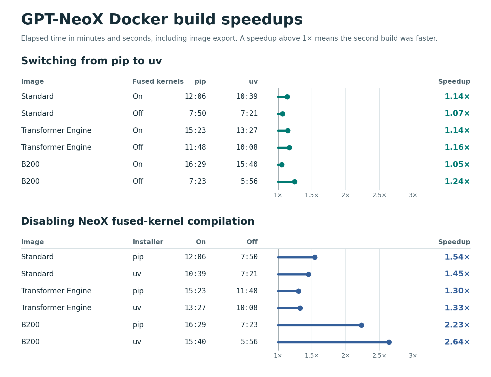

# GPT-NeoX Container Image Guide

This guide covers the Docker images and native Apptainer definitions, plus
conversion from Docker to Apptainer. Run the build commands from the
`gpt-neox` repository root so the recipes can access the requirements and
fused kernel sources.

```bash
cd gpt-neox
```

The pip-based Docker and Apptainer definitions use public PyPI by setting
`PIP_CONFIG_FILE=/dev/null`, `PIP_INDEX_URL=https://pypi.org/simple`, and an empty
`PIP_EXTRA_INDEX_URL` before installing Python packages. These settings are
retained in the finished image. Disabling inherited pip configuration files
avoids DNS retries against the legacy `pypi.ngc.nvidia.com` extra index from
NGC base images. Other file-based pip settings are also disabled; environment
variables such as `PIP_CONSTRAINT` remain active.

## Image Matrix

| Image | Dockerfile | Base image | CUDA architecture | Use case |
| --- | --- | --- | --- | --- |
| `gpt-neox:latest` | `containers/docker/Dockerfile` | `nvcr.io/nvidia/pytorch:24.02-py3` | Base defaults | Standard GPT-NeoX image. |
| `gpt-neox:te` | `containers/docker/Dockerfile.TE` | `nvcr.io/nvidia/pytorch:24.02-py3` | `9.0` | Transformer Engine and FlashAttention on Hopper-class GPUs such as H100. |
| `gpt-neox:b200` | `containers/docker/Dockerfile.B200` | `nvcr.io/nvidia/pytorch:25.04-py3` | `10.0` | B200 systems that require the newer PyTorch and CUDA stack from NGC 25.04. |

## TE Image

Use `containers/docker/Dockerfile.TE` for the Transformer Engine image built on
the NGC PyTorch 24.02 base.

The image:

- installs `requirements.txt` and `requirements-onebitadam.txt`
- installs `wandb==0.16.6`
- installs `transformer-engine[pytorch]==1.12`
- installs `flash-attn==2.5.6`
- pins `protobuf==4.25.8` to satisfy the cuDF requirement in NGC 24.02
- sets `TORCH_CUDA_ARCH_LIST=9.0`
- builds the GPT-NeoX fused kernels from `megatron/fused_kernels/`

In both the pip and uv TE images, the FlashAttention setup script tries to
download a matching upstream wheel. If none is available, it compiles against
the PyTorch in the base image.

Build the image:

```bash
docker build -f containers/docker/Dockerfile.TE -t gpt-neox:te .
```

Verify the image:

```bash
docker run --rm --gpus all --ipc=host gpt-neox:te nvidia-smi
docker run --rm --gpus all --ipc=host gpt-neox:te \
  python -c "import torch, wandb, flash_attn, transformer_engine; print(torch.__version__)"
```

## B200 Image

Use `containers/docker/Dockerfile.B200` for B200 systems. B200 support requires
a newer PyTorch and CUDA stack, so this image moves to the NGC PyTorch 25.04
base.

Both B200 recipes run as `mchorse`. They use UID 1000 when it is free and
allocate an available UID when the base image already has a user at 1000.
For bind-mount permissions, check the resulting UID with
`docker run --rm gpt-neox:b200 id -u` (use `gpt-neox:b200-uv` for the uv image).

The image:

- installs `requirements.txt` and `requirements-onebitadam.txt`
- installs W&B and Protobuf from `requirements-wandb.txt`
- sets `TORCH_CUDA_ARCH_LIST=10.0`
- relies on the NGC 25.04 base image for Transformer Engine
- rewrites `jinja2==3.1.4` to `jinja2==3.1.6` during the build to match the
  NGC base-image pip constraint
- updates the base image's Protobuf constraint to match `requirements-wandb.txt`
- pins `fsspec==2024.6.1` and `dill==0.3.8` for compatibility with Datasets 2.x
- removes `chardet` after installation to avoid the `requests` dependency
  warning emitted during W&B imports in this base image
- builds the GPT-NeoX fused kernels from `megatron/fused_kernels/`

Build the image:

```bash
docker build -f containers/docker/Dockerfile.B200 -t gpt-neox:b200 .
```

Verify the image:

```bash
docker run --rm --gpus all --ipc=host gpt-neox:b200 nvidia-smi
docker run --rm --gpus all --ipc=host gpt-neox:b200 \
  python -c "import torch, wandb, transformer_engine; print(torch.__version__)"
```

## Skipping the GPT-NeoX Fused Kernel Build

All Docker images and both native Apptainer definitions build the GPT-NeoX
fused kernels by default. Pass `--build-arg BUILD_FUSED_KERNELS=false` to skip
this step. The examples below use the pip-based recipes.

```bash
docker build --build-arg BUILD_FUSED_KERNELS=false \
  -f containers/docker/Dockerfile -t gpt-neox:no-fused-kernels .
```

With Apptainer 1.2 or later, bind the requirements directory for the pip-based
recipe. The kernel flag lets you omit the fused kernel source bind.

```bash
apptainer build --build-arg BUILD_FUSED_KERNELS=false \
  --bind "$PWD/requirements:/requirements:ro" \
  gpt-neox-no-fused-kernels.sif containers/apptainer/gpt-neox.def
```

The flag controls GPT-NeoX's own extensions. The Transformer Engine image
installs FlashAttention with either setting. To avoid compiling the GPT-NeoX
extensions at runtime, set `scaled_upper_triang_masked_softmax_fusion`,
`scaled_masked_softmax_fusion`, and `rope_fusion` to `false` in the model config.

## Building with uv

The uv variants install Python packages into the base image's Python
environment and honor its package constraints. Build from the repository root.

| Variant | Build definition | Example image |
| --- | --- | --- |
| Standard | `containers/docker/Dockerfile.uv` | `gpt-neox:uv` |
| Transformer Engine | `containers/docker/Dockerfile.TE.uv` | `gpt-neox:te-uv` |
| B200 | `containers/docker/Dockerfile.B200.uv` | `gpt-neox:b200-uv` |
| Apptainer 1.2+ | `containers/apptainer/gpt-neox.uv.def` | `gpt-neox-uv.sif` |

```bash
docker build -f containers/docker/Dockerfile.uv -t gpt-neox:uv .
docker build -f containers/docker/Dockerfile.TE.uv -t gpt-neox:te-uv .
docker build -f containers/docker/Dockerfile.B200.uv -t gpt-neox:b200-uv .
apptainer build gpt-neox-uv.sif containers/apptainer/gpt-neox.uv.def
```

The uv Apptainer definition copies the build inputs from the checkout. Both
the Docker and Apptainer uv recipes accept `BUILD_FUSED_KERNELS=false`.

## Docker build timings

Times are wall-clock minutes and seconds for one `docker build --pull --no-cache` per configuration, including image export. The speedup is pip time divided by uv time.



## Running a Container

Set the host paths that should be mounted into the container:

```bash
export NEOX_DATA_PATH=/path/to/data
export NEOX_CHECKPOINT_PATH=/path/to/checkpoints
export WANDB_API_KEY=your_wandb_key
```

Start an interactive shell:

```bash
docker run --rm -it \
  --gpus all \
  --ipc=host \
  --ulimit memlock=-1 \
  -e WANDB_API_KEY=$WANDB_API_KEY \
  -v $NEOX_DATA_PATH:/home/mchorse/data \
  -v $NEOX_CHECKPOINT_PATH:/home/mchorse/chk \
  -v $(pwd):/home/mchorse/gpt-neox \
  gpt-neox:te \
  bash
```

Use `gpt-neox:b200` instead of `gpt-neox:te` when running the B200 image.

## Apptainer Equivalents

If your HPC environment requires Apptainer, convert the Docker images into
`.sif` files. When Docker is available on the build host, convert directly from
the local Docker daemon:

```bash
apptainer build containers/apptainer/gpt-neox-te-from-docker.sif docker-daemon://gpt-neox:te
apptainer build containers/apptainer/gpt-neox-b200-from-docker.sif docker-daemon://gpt-neox:b200
```

If Docker is not available on the target system, push the Docker images to a
registry from a Docker-capable host and build from the registry instead:

```bash
apptainer build gpt-neox-te.sif docker://your-registry/gpt-neox:te
apptainer build gpt-neox-b200.sif docker://your-registry/gpt-neox:b200
```

Verify the Apptainer images with `--nv` to enable NVIDIA GPU support:

```bash
apptainer exec --nv containers/apptainer/gpt-neox-te-from-docker.sif \
  python -c "import torch, wandb, flash_attn, transformer_engine; print(torch.__version__)"
apptainer exec --nv containers/apptainer/gpt-neox-b200-from-docker.sif \
  python -c "import torch, wandb, transformer_engine; print(torch.__version__)"
```

For `.sif` files produced from registry images, use the same
`apptainer exec --nv ...` pattern with the generated filenames.
